# STM32 LED Voltage Measurement using Keil µVision, ADC and UART


## Project Overview

This project measures the voltage of an LED using the on-chip 12-bit ADC of an STM32F446RE Nucleo board. The LED is switched ON and OFF automatically, and the calculated LED voltage is sent to the PC over UART.

It is a standalone **Keil µVision** project written entirely at register level, without HAL or LL libraries. GPIO, ADC1, USART2 and SysTick are configured by writing directly to their registers. The program is built, flashed and debugged through the on-board **ST-LINK**.

The serial output is viewed in a **Windows PowerShell** window, so no separate serial monitor software is needed.

## Key Features

- Standalone Keil µVision project with register-level programming
- 12-bit ADC measurement of the LED voltage on PA0
- LED switches ON and OFF automatically
- LED voltage printed over UART at 115200 baud
- Programming through the on-board ST-LINK
- Serial output viewed directly in PowerShell
- Complete project creation steps with screenshots

## Hardware Required

| Component | Quantity |
|-----------|----------|
| STM32F446RE Nucleo board (with on-board ST-LINK/V2-1) | 1 |
| LED | 1 |
| Jumper wires | As needed |
| USB cable (data cable) | 1 |

The USB cable powers the board, programs it through ST-LINK, and provides the virtual COM port for the serial output.

## System Architecture

```
   PA8 (D7) ──► LED ON / OFF
                   │
                   ▼
          PA0 (A0) ADC1 Channel 0
                   │
                   ▼
       ADC value → LED voltage
                   │
                   ▼
     USART2 TX (PA2) → ST-LINK Virtual COM Port
                   │
                   ▼
        PowerShell window (COM port)
```

## Pin Configuration

| Function | STM32 Pin | Nucleo Label | Mode |
|----------|-----------|--------------|------|
| LED control | PA8 | D7 | GPIO output |
| Voltage sense | PA0 | A0 | Analog input (ADC1, channel 0) |
| UART TX | PA2 | - | Alternate function AF7 (USART2_TX) |

## Code

The project has a single source file:

```
STM32F446RE-Keil-LED-Voltage-Measurement/
├── LED_Voltage_sensor.c
├── LED_ON.jpeg
├── LED_OFF.jpeg
├── New_project.png
├── File_name.png
├── Select_Device.png
├── Manage_Run_Time.png
├── Add_New_Item.png
├── C_File.png
├── ST_link.jpeg
├── Debug_Flash.jpeg
├── Flash_reset_run.jpeg
├── MainC_Build.jpeg
├── MainC_Flash.jpeg
├── PowerShell.jpeg
└── README.md
```

### Peripherals Used

| Peripheral | Purpose |
|------------|---------|
| GPIOA | LED control (PA8), analog input (PA0), UART pin (PA2) |
| ADC1 | Reads the LED voltage on channel 0 |
| USART2 | Sends the readings to the PC at 115200 baud |
| SysTick | Provides 1 ms delays from the 16 MHz HSI clock |

## Keil Setup

### Step 1: Create a New Project

In Keil µVision, go to **Project → New µVision Project**.

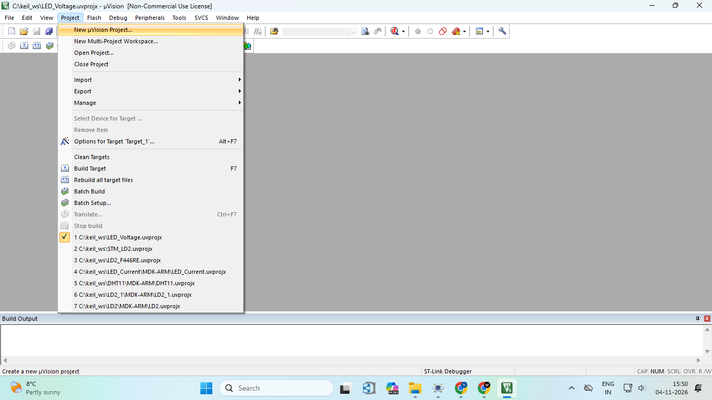

### Step 2: Name and Save the Project

Choose the project folder (`C:\keil_ws`), enter the project name `LED_Voltage` and click **Save**.

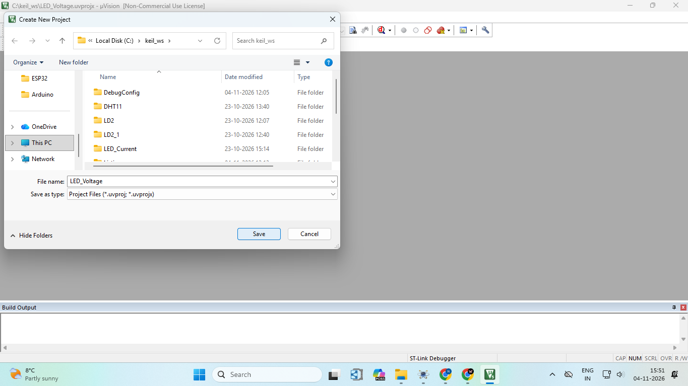

### Step 3: Select the Device

Search for `f446re` and select **STM32F446RETx** under STMicroelectronics → STM32F4 Series → STM32F446 → STM32F446RE. Click **OK**.

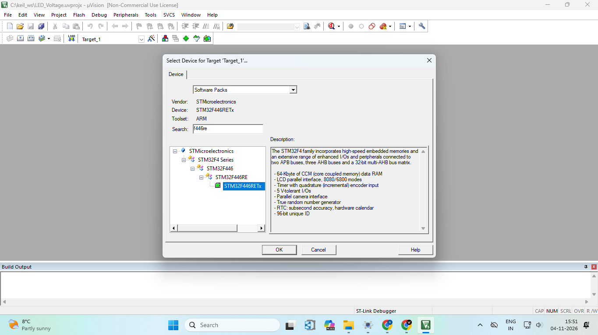

### Step 4: Manage Run-Time Environment

In the Run-Time Environment window, enable these two components, then click **OK**:

| Component | Selection |
|-----------|-----------|
| CMSIS → CORE | Enabled |
| Device → Startup | Enabled |

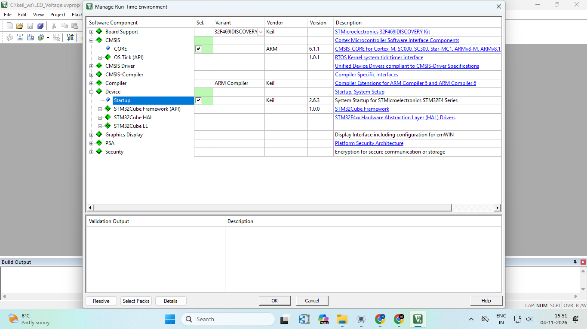

### Step 5: Add a New Item to the Source Group

In the Project window, right-click **Source Group 1** and select **Add New Item to Group 'Source Group 1'**.

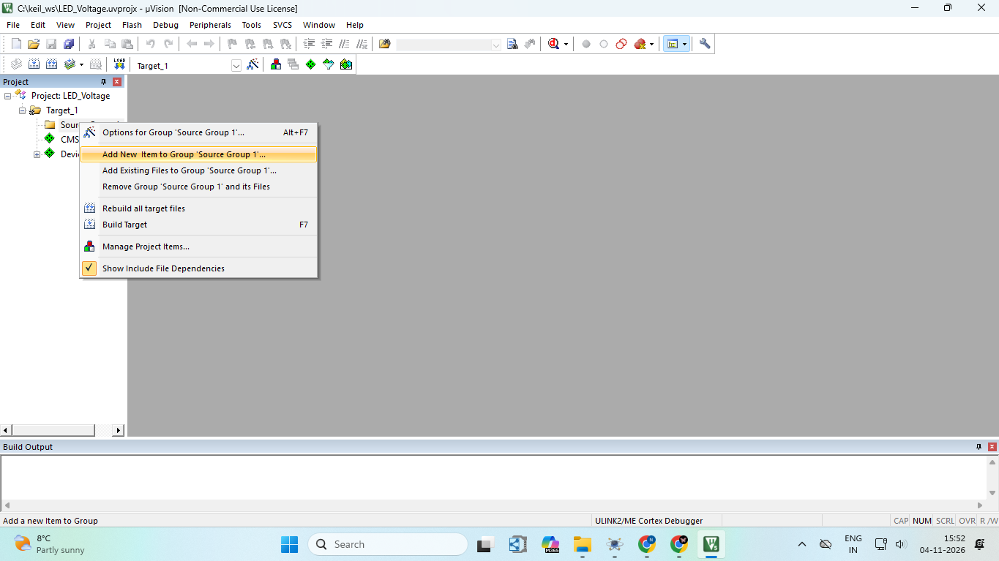

### Step 6: Create the C File

Select **C File (.c)**, enter the file name and click **Add**. Then paste the project code into the new file.

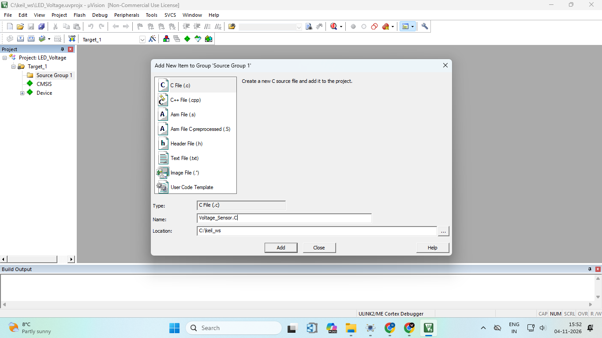

### Step 7: Select the ST-Link Debugger

Go to **Project → Options for Target → Debug** tab. Under **Use**, select **ST-Link Debugger**, then click **Settings**.

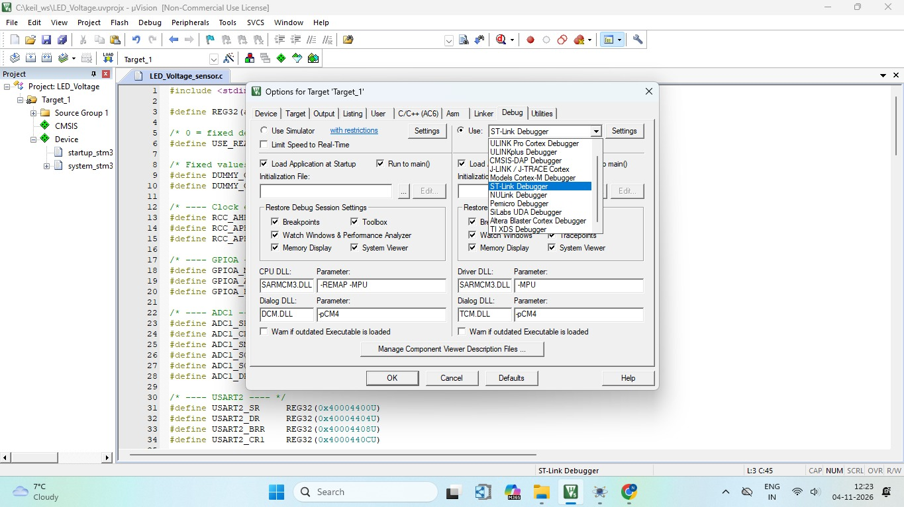

### Step 8: Check the ST-Link Debug Settings

In the **Debug** tab of the Cortex-M Target Driver Setup, the ST-Link is detected as **ST-LINK/V2-1** and the target is found over the **SW** port.

| Setting | Value |
|---------|-------|
| Unit | ST-LINK/V2-1 |
| Port | SW |
| Clock | 10 MHz requested, 1.800 MHz selected |
| Connect | Normal |
| Reset | Autodetect |
| Reset after Connect | Enabled |
| Cache Code / Cache Memory | Enabled |
| Download to Flash | Enabled |

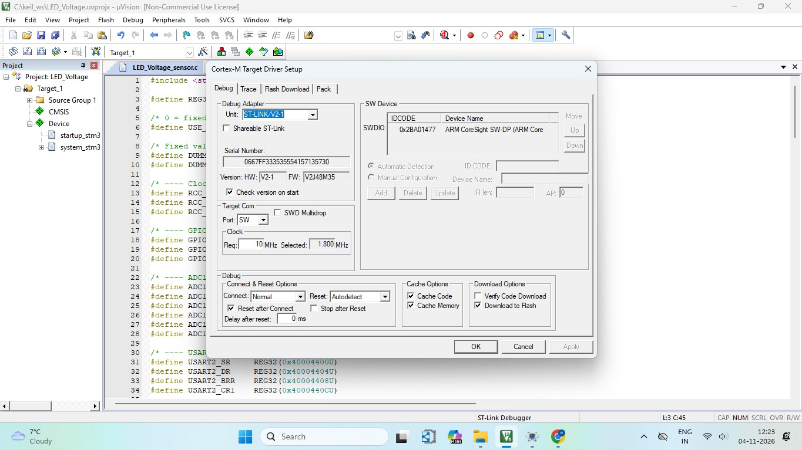

### Step 9: Set the Flash Download Options

In the **Flash Download** tab, the programming algorithm is **STM32F4xx 512kB Flash** (08000000H - 0807FFFFH).

| Setting | Value |
|---------|-------|
| Download Function | Erase Sectors |
| Program | Enabled |
| Verify | Enabled |
| Reset and Run | Enabled |
| RAM for Algorithm | Start 0x20000000, Size 0x1000 |

Click **OK** to save the settings. With **Reset and Run** enabled, the program starts automatically after flashing.

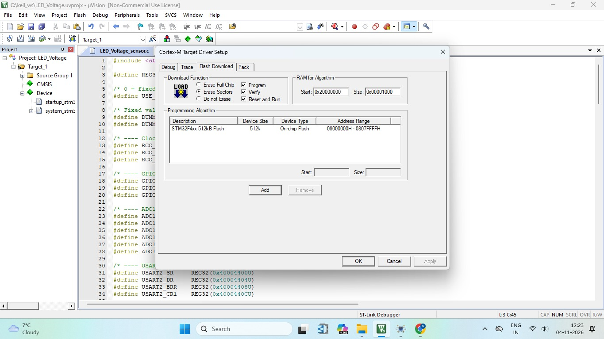

### Step 10: Build the Project (F7)

Press **F7** or click **Build**. The Build Output shows the program size and `0 Error(s), 0 Warning(s)`.

| Item | Size (bytes) |
|------|--------------|
| Code | 1376 |
| RO-data | 524 |
| RW-data | 0 |
| ZI-data | 1632 |

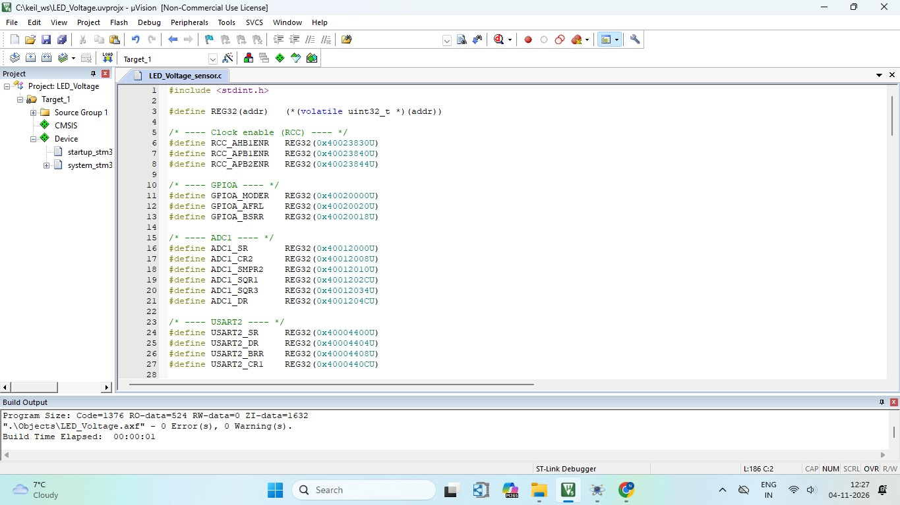

### Step 11: Flash the Program (F8)

Press **F8** or click **Download**. The Build Output shows `Verify OK`, `Application running ...` and `Flash Load finished`.

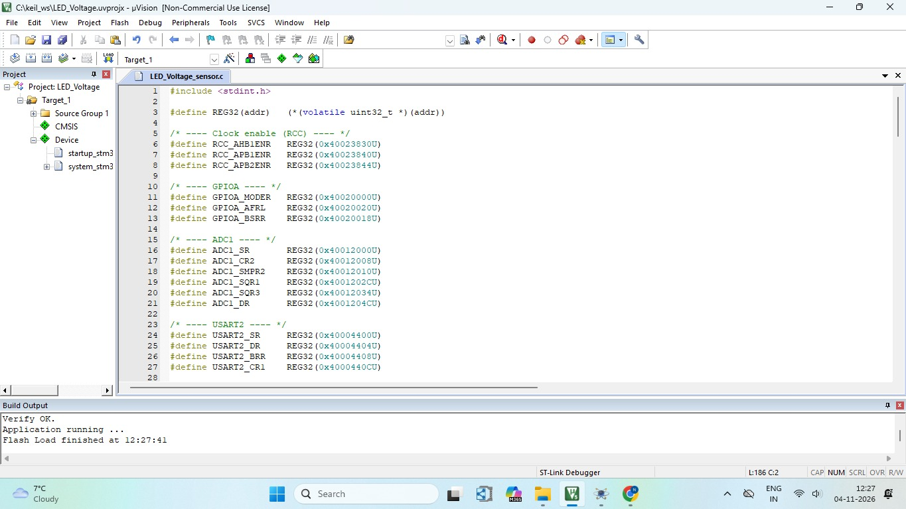

## Working

### LED ON

PA8 (D7) is driven HIGH and the LED turns ON. The ADC reads the LED voltage and the value is printed over UART.

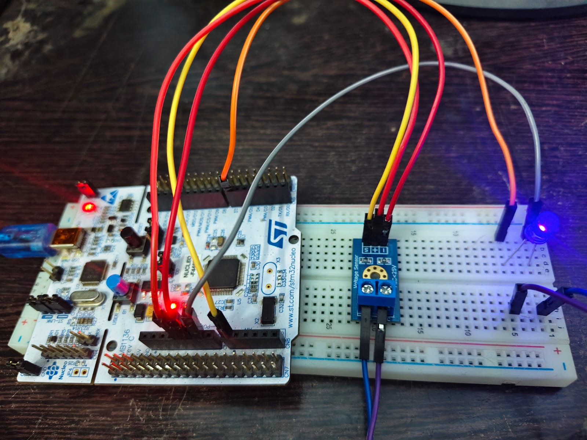

### LED OFF

PA8 is driven LOW and the LED turns OFF. The ADC reads 0 V and the terminal shows 0.000 V.

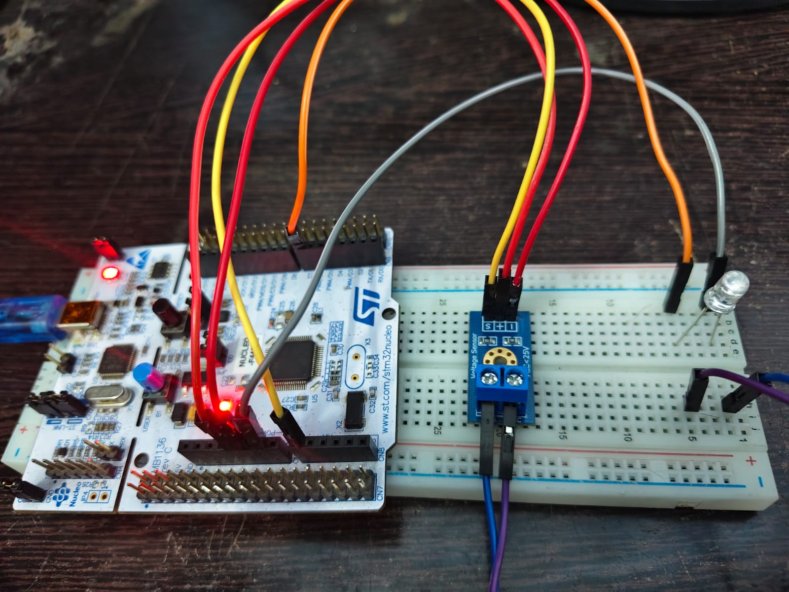

### Overall Flow

1. PA8 goes HIGH and the LED turns ON.
2. ADC1 reads the voltage on PA0.
3. The LED voltage is printed over UART.
4. PA8 goes LOW and the LED turns OFF.
5. The LED voltage is printed again.
6. The loop repeats continuously.

```
LED ON → Read ADC → Print → LED OFF → Read ADC → Print → repeat
```

## Output

The readings are shown in the Windows PowerShell window:

```
LED OFF | LED voltage=0.000 V
LED OFF | LED voltage=0.000 V
LED OFF | LED voltage=0.000 V
LED OFF | LED voltage=0.000 V
LED ON  | LED voltage=2.000 V
LED ON  | LED voltage=2.000 V
LED ON  | LED voltage=2.000 V
LED ON  | LED voltage=2.000 V
```

| Field | Meaning |
|-------|---------|
| LED ON / OFF | Current LED state |
| LED voltage | Calculated LED voltage in volts |

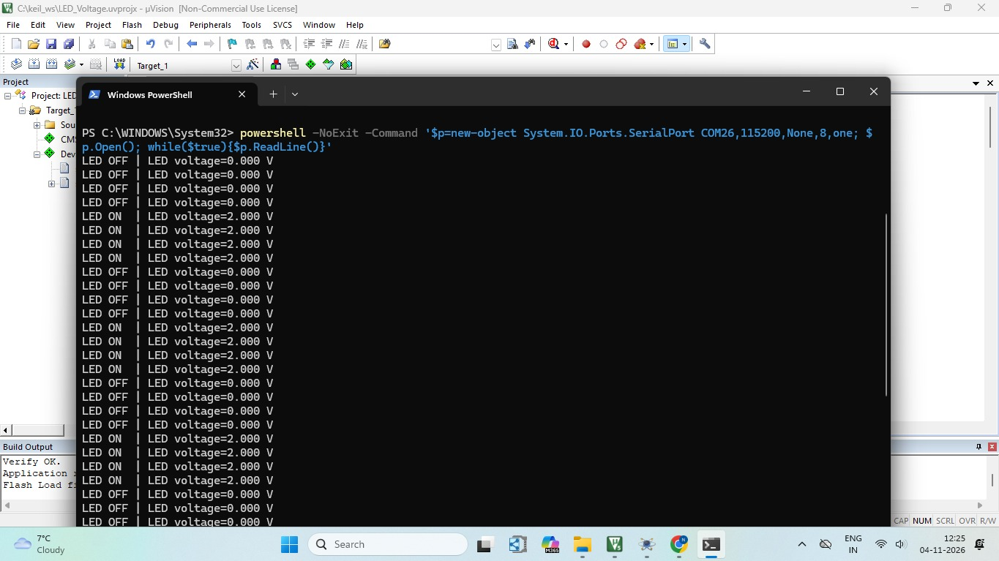

## How to Run

1. Create the project and add the source file by following Steps 1 to 6 in the Keil Setup section.
2. Configure the ST-Link debugger and the Flash Download options (Steps 7 to 9).
3. Press **F7** to build.
4. Press **F8** to flash the board.
5. Find the ST-LINK COM port number in **Device Manager → Ports (COM & LPT)**.
6. Open a **Windows PowerShell** window and run this command:

```powershell
powershell -NoExit -Command '$p=new-object System.IO.Ports.SerialPort COM26,115200,None,8,one; $p.Open(); while($true){$p.ReadLine()}'
```

7. Replace `COM26` with your own COM port number. The LED readings appear in the window.

### Serial Settings

| Setting | Value |
|---------|-------|
| Baud rate | 115200 |
| Data bits | 8 |
| Parity | None |
| Stop bits | 1 |

## Important Notes

### COM Port

Only one program can use a COM port at a time. Close any other serial monitor before running the PowerShell command, otherwise the port will not open.

### Voltage Limit

The voltage at PA0 must never exceed 3.3 V.

### USB Cable

Use a data-capable USB cable. Some cables only charge, and the ST-LINK will not be detected.

## Technologies and Concepts

- STM32F446RE (ARM Cortex-M4)
- Keil µVision
- Embedded C
- Bare-metal register programming
- ADC voltage measurement
- UART communication
- SysTick timer delays
- ST-LINK debugging and flashing

## Future Improvements

- Display the voltage on an LCD
- Measure the LED current to calculate power
- Use ADC with DMA for continuous sampling
- Log the readings to a PC for plotting

# 🎥 Project Video

[▶️ Watch the Project Demonstration](https://drive.google.com/file/d/1aReeic8fbH7ViyWX41yyk-cgINyRxGlP/view?usp=drivesdk)
